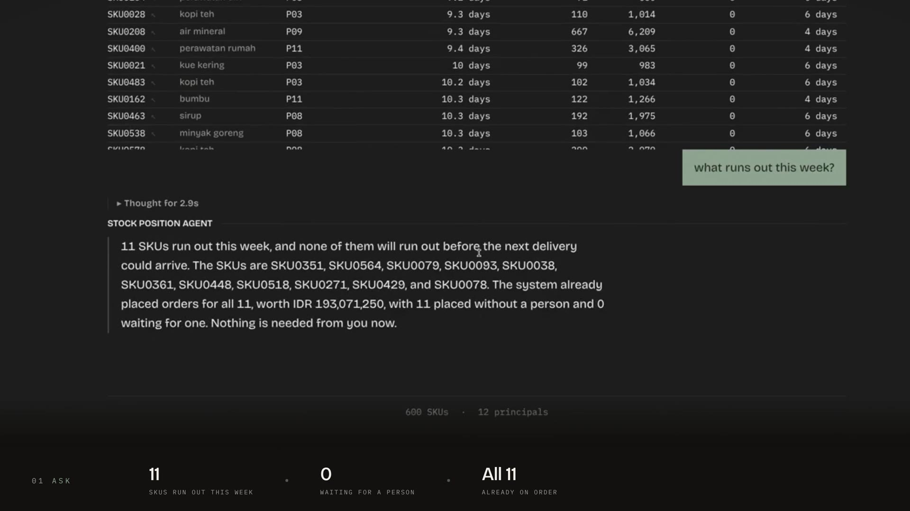

# Pasok

Agen pemesanan otomatis untuk distributor FMCG Indonesia. Empat agent menjalankan satu loop:
mengamati, meramal, memutuskan, menerbitkan, lalu belajar. Order keluar di bawah guardrail yang menjaga
varians order tetap dekat dengan varians permintaan, supaya agent bisa merencanakan lonjakan hari raya
tanpa memicu bullwhip effect.

Agentic AI Hackathon 2026, Track A (Intelligence Supply Chain), SOKRATES / BINUS Alam Sutera.
Tim Pasok, Sistem Informasi, Universitas Katolik Atma Jaya.

**Status:** finalis 40 besar. Demo Day 31 Oktober 2026.

[](media/demo-day-2026.mp4)

Klik gambar untuk rekaman demo (3 menit 52 detik, 28 MB). Halaman ini terjemahan dari
[README.md](README.md), versi Inggris yang lebih rinci.

## Empat agent

| Agent | Tugas |
| --- | --- |
| Demand | forecast per SKU dengan interval, ramp event yang dipelajari per SKU, kandidat event untuk dikurasi manusia, buffer per supplier yang dibatasi umur simpan |
| Stock Position | satu angka sellable (stok + di jalan + open PO), days of cover terhadap forecast, flag tutup-bulan dan risiko kedaluwarsa |
| Supplier Reliability | lead time p50/p90 dan fill rate yang dipelajari dari catatan penerimaan, deteksi drift |
| Decision | orkestrator: terbitkan otomatis, tahan satu siklus, alihkan ke depot cabang, atau eskalasi — dengan alasan tertulis di setiap keputusan |

Guardrail: forecast dihaluskan sebelum sizing, kuantitas diperlambat terhadap order sebelumnya, ada cap
per order. Uplift event diletakkan di luar peredam tapi di dalam batas umur simpan.

## Angka

**Snapshot artefak di repo ini, 31 Oktober 2026** — dihasilkan ulang oleh `bash run_chain.sh`:

| Ukuran | Nilai | File |
| --- | --- | --- |
| SKU / outlet / hari / baris penjualan | 600 / 120 / 1.399 / 10.034.120 | `data/catalog/meta.json` |
| SKU dapat order / dilewati | 470 / 130 | `data/agents/decision_summary.json` |
| Unit setelah guardrail vs mentah | 3.169.930 vs 3.194.155 | `data/agents/decision_summary.json` |
| Variance cap mengikat | 8 SKU, memotong 24.225,4 unit | `data/agents/decision_summary.json` |
| Order terbit otomatis | 470 (100%), Rp30.123.910.900 | `data/orders/order_summary.json` |
| Okupansi gudang | 3.195,1 dari 12.500 m³ | `data/orders/order_summary.json` |
| Transfer antar cabang | 467 transfer, 5 depot, Rp10.216.545.412 terlindungi dari Rp15.512.068.197 berisiko | `data/orders/redirect_summary.json` |
| Fill rate teramati | 90,47% | `data/agents/learn_summary.json` |
| WAPE forecast median terbaik | 12,91% | `data/agents/learn_summary.json` |
| SKU di bawah reorder / risiko kedaluwarsa | 38 / 6 | `data/stock/position_summary.json` |
| Penjualan hilang sepanjang replay | 880.472 unit | `data/stock/position_summary.json` |

**Jalan Demo Day, 21 Oktober 2026** (dikutip `docs/MODUL_PASOK.md`, snapshot lebih awal): 600 SKU,
139 baris order diputuskan, 121 keluar otomatis (Rp13.421.740.570) dan 18 menunggu manusia
(Rp3.437.202.355). Dokumen demo memakai snapshot 11–21 Oktober; artefak di `data/` sudah snapshot
31 Oktober.

Jejak satu SKU ada di `data/agents/one_pass.json`: SKU0421 dari persepsi sampai penilaian.

## Jalankan

```bash
python -m venv .venv
.venv/bin/pip install pandas numpy matplotlib pyarrow
.venv/bin/python src/catalog/generate.py   # bangun katalog sintetis (sekali)
bash run_chain.sh                          # rantai sebelas program, berakhir CHAIN OK
```

Rantainya deterministik dan tidak butuh akun. Setiap agent mencetak `VERIFICATION PASS` kalau
aritmetikanya cocok dengan artefaknya sendiri.

Audit build:

```bash
.venv/bin/python tools/integration_audit.py      # 11 serah-terima dibuktikan dari artefak
.venv/bin/python tools/test_cases.py             # TC-1 stok habis dalam sepekan, TC-2 lonjakan dalam sebulan
.venv/bin/python tools/proposal_conformance.py   # build vs REQUIREMENTS.md, dibaca langsung dari disk
.venv/bin/python tools/figures_gate.py           # 42 gambar yang dikutip demo, vs artefaknya
.venv/bin/python tools/target_measure.py         # lima target proposal, diukur per kelas ABC
```

## Jalankan konsolnya

```bash
.venv/bin/pip install -r requirements-web.txt
PASOK_WEB_PORT=8080 .venv/bin/python web/app.py
```

Buka http://localhost:8080. Konsol membaca `data/` apa adanya setelah `run_chain.sh`, jadi isinya
snapshot yang baru dijalankan. Sudah dites di sini: `/`, `/orders`, `/loop`, `/health`, `/suppliers`,
`/transfers`, `/catalog`, dan `/panel` semuanya 200 (Python 3.8, fastapi + uvicorn).

## Isi repo

```
src/agents/      empat agent dan loop-nya
src/catalog/     generator katalog distributor sintetis (SKU x outlet x minggu)
src/demand/      baseline, registry event, pembelajaran ramp per SKU
src/sap/         scoring batch sap-rpt-1.6, rationale gpt-5.4
tools/           audit, backtest, benchmark, ERP distributor pengganti
web/             konsol publik read-only, halaman-halamannya
data/            artefak yang dibaca dan ditulis loop (sebagian ikut di repo)
demo/            paket demo: naskah, slide, gambar, eval, arsitektur
docs/            modul lengkap 22 bagian, audit angka, catatan teknis
aws/             status gerbang AWS dan perintah reproduksinya
simulation/      simulasi guardrail di atas indeks ritel Bank Indonesia
experiments/     evaluasi ramp event M5
```

## Yang nyata dan yang pengganti

Baca `demo/evals.md` sebelum mengutip angka. Ringkasnya:

- Scoring dan reasoning berjalan di SAP AI Core: sap-rpt-1.6 untuk days-of-cover / stockout / expiry,
  gpt-5.4 untuk rationale.
- Manusia dalam loop adalah Joule: `pasok_exception_queue` hidup di tenant.
- Jalur AWS berjalan di Lambda dengan Bedrock lewat endpoint Mantle. AgentCore Runtime kuotanya nol di
  akun ini dan `Converse` native Bedrock dibatasi akun; keduanya dicatat dengan perintah reproduksi di
  `aws/GATES.md`.
- Order keluar lewat intake yang bisa diganti. Sistem order distributor di sini adalah ERP pengganti
  dengan aturan, urutan referensi, dan database SQLite sendiri; pindah ke ERP sungguhan cukup satu
  variabel lingkungan (`PASOK_ORDER_ENDPOINT`).
- Data sintetis dan realistis, yang memang diizinkan FAQ panitia Q2.

## Batas

- Katalog 600 SKU sintetis (seed `20261008`), bukan data klien.
- `data/` memuat masukannya (katalog, event, ramp per SKU, kelas ABC, volume gudang) dan keluarannya.
  Dua berkas besar tidak ikut karena bisa dibangun ulang: `data/catalog/sales.csv` (240 MB) dan
  `data/stock/stock_daily.csv`, keduanya dihasilkan `src/catalog/generate.py` lalu `run_chain.sh`.
- Rekaman video demo ada di `media/demo-day-2026.mp4`; berkas video mentah tidak ikut.
- `demo/deck/check_deck_numbers.py` akan melaporkan sembilan angka bergeser, dan itu wajar: deck dibuat
  untuk Demo Day 21 Oktober (137 order, Rp7,71 miliar), sedangkan `data/` di sini snapshot 31 Oktober.
  `src/catalog/generate.py` menyemai riwayat sampai hari ia dijalankan, jadi angka demo tidak kembali.

## Dokumen

- `docs/MODUL_PASOK.md` — modul lengkap 22 bagian, versi cetak di `docs/MODUL_PASOK.pdf`
- `docs/AUDIT_MODUL.md` — audit angka modul terhadap artefak
- `demo/script_en.md` — naskah demo 15 menit
- `demo/evals.md` — apa yang terbukti dan apa yang tidak
- `proposal_pasok_v2_canonical.txt` — proposal yang dikirim

## Kredit

Dibangun oleh Vicentius Elang Krisnanto untuk Agentic AI (SAP) 2026. Lisensi MIT, lihat `LICENSE`.

Kontak: elangk111@gmail.com · [github.com/Elang02](https://github.com/Elang02)
