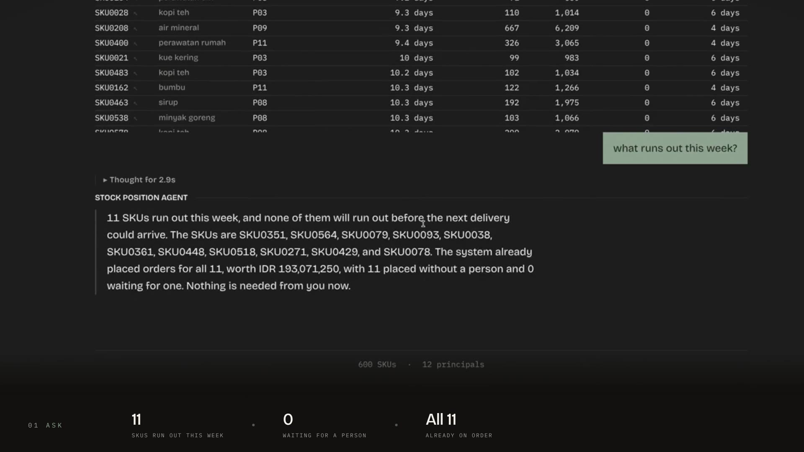
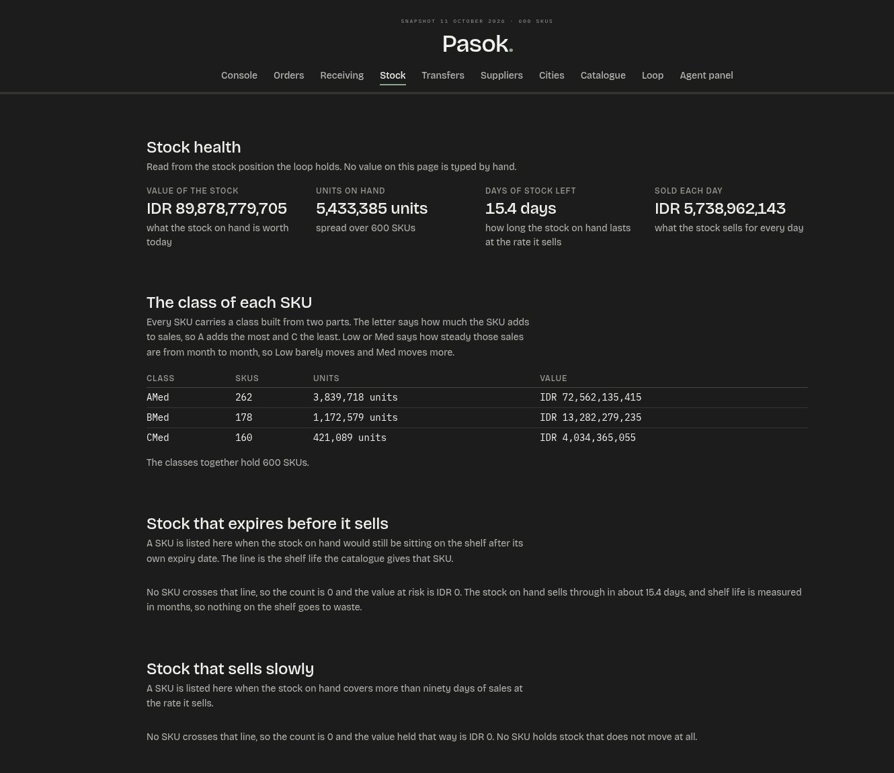
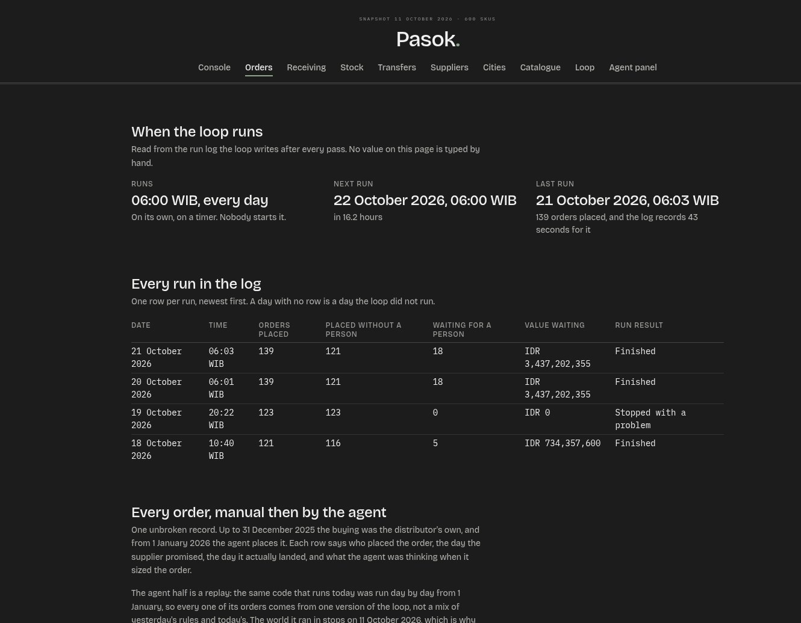
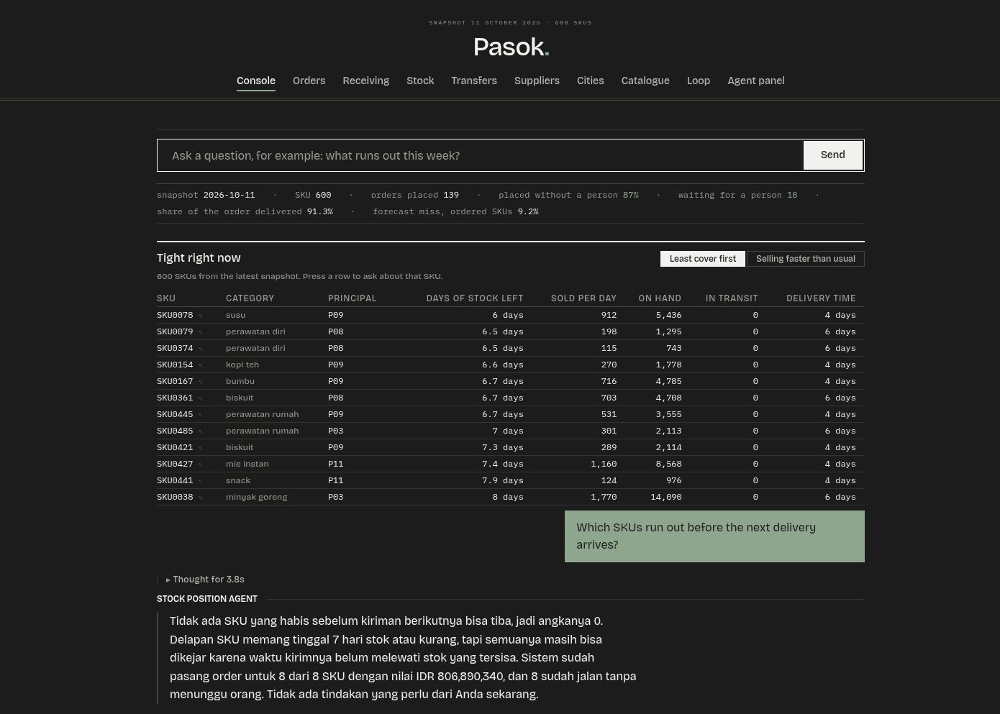

# Pasok

Agen pemesanan otomatis untuk distributor FMCG. Sistem ini memutuskan barang apa yang harus dipesan,
berapa banyak, dan kapan, lalu menuliskan alasannya dalam bahasa yang bisa dibaca buyer.

Dibuat untuk **Agentic AI (SAP) 2026**. Masuk 40 tim finalis, ikut Road to Glory 1–30 Oktober, dan
tampil di Demo Day 31 Oktober 2026 di BINUS Alam Sutera.

Klik gambar untuk video demo (3 menit 52 detik, 28 MB).

---

## Masalah

Distributor mengulang pekerjaan yang sama tiap minggu: melihat stok, menebak penjualan, memutuskan
order, dan menjelaskan keputusannya ke atasan. Tiga hal biasanya rusak di situ.

- Stok gudang dilihat sendirian, padahal barang sudah ada yang di jalan dan ada yang masih open PO.
  Hasilnya order ganda.
- Event Indonesia (Ramadan, Lebaran, Imlek, THR, akhir tahun) mengubah pola permintaan, tapi anggaran
  order tetap datar.
- Keputusan tidak punya jejak. Kalau ordernya salah, tidak ada yang bisa ditunjuk.

Pasok mengerjakan satu putaran lima langkah untuk 600 SKU sekaligus: lihat posisi stok, forecast
penjualan, putuskan order, kirim ke sistem order, lalu nilai hasilnya setelah barang datang.

## Cara kerja

**Empat agent, satu keputusan.**

| Agent | Masukan | Keluaran |
| --- | --- | --- |
| Demand | Riwayat penjualan per outlet, kalender event, kelas ramp | Forecast harian, pita ketidakpastian, tanda kenaikan yang belum dijelaskan |
| Stock Position | Stok gudang, barang di jalan, open PO | Satu angka sellable, days of cover, tanda perlu order, tanda risiko kedaluwarsa |
| Supplier Reliability | Catatan penerimaan | Lead time p50/p90, fill rate, tanda drift |
| Decision | Ketiga di atas, plus credit headroom, umur simpan, holding cost | Satu action per SKU, jumlah, dan alasan yang bisa dibaca |

**Yang deterministik, yang tidak.** Forecast, guardrail, dan aritmetika order adalah kode. Model bahasa
hanya menulis alasan dan menjawab pertanyaan di konsol. Ini keputusan desain: angka tidak boleh
berubah karena kalimatnya diubah.

**Guardrail sebelum order keluar.** Credit limit, umur simpan, holding cost, pembulatan kemasan, dan
variance cap per SKU. Order yang lolos keluar otomatis; yang tidak, masuk antrean manusia dengan
alasan yang tertulis.

**Jejak satu SKU.** `data/agents/one_pass.json` merekam SKU0421 dari persepsi sampai penilaian:
sellable 2.078,6 unit, velocity 292,79 unit/hari, days of cover 7,1 hari, order mentah 2.249,4 unit,
dipotong variance cap jadi 2.159,1 unit, PO-0032 terbit otomatis Rp82.045.800, lalu dinilai
`SUPPLY_SHORT` dengan fill rate teramati 85,98%.

## Angka

Dua jalan berbeda tanggal, jadi angkanya berbeda. Keduanya nyata.

**Jalan terakhir, 21 Oktober 2026** (dari `docs/MODUL_PASOK.md`):

| Ukuran | Nilai |
| --- | --- |
| SKU diperiksa | 600 |
| Baris order diputuskan | 139 |
| Keluar otomatis / menunggu manusia | 121 / 18 |
| Nilai order otomatis | Rp13.421.740.570 |
| Nilai menunggu manusia | Rp3.437.202.355 |

**Artefak yang ikut di repo, snapshot 11 Oktober 2026** (`data/`):

| Ukuran | Nilai | File |
| --- | --- | --- |
| SKU dapat order / dilewati | 137 / 463 | `data/agents/decision_summary.json` |
| Order otomatis / eskalasi | 130 (94,9%) / 7 | `data/orders/order_summary.json` |
| Nilai order | Rp7.707.789.750 | `data/orders/order_summary.json` |
| Transfer antar cabang | 412 transfer, 5 depot, Rp19.085.275.501 terlindungi | `data/orders/redirect_summary.json` |
| Fill rate teramati | 91,26% | `data/agents/learn_summary.json` |
| WAPE forecast, median terbaik | 8,52% | `data/agents/learn_summary.json` |
| Variance cap mengikat | 80 SKU, memotong 242.111,9 unit dari 680.072 unit mentah | `data/agents/decision_summary.json` |
| SKU perlu order / risiko kedaluwarsa | 63 / 0 | `data/stock/position_summary.json` |
| Katalog | 600 SKU, 120 outlet, 1.379 hari, 9.898.449 baris penjualan | `data/catalog/meta.json` |

## Isi repo

| Path | Isi |
| --- | --- |
| `docs/MODUL_PASOK.md` | Modul lengkap 22 bagian: dua belas fitur, rantai sebelas program, bukti dan batasan, glosarium, latihan menjawab |
| `docs/MODUL_PASOK.pdf` | Versi cetak modul |
| `docs/AUDIT_MODUL.md` | Audit angka modul terhadap artefak, dengan nilai yang dikoreksi |
| `docs/demo/` | Naskah demo bahasa Inggris, alur satu putaran, daftar gambar, kerangka slide |
| `media/demo-day-2026.mp4` | Rekaman demo 3:52 |
| `media/*.jpg` | Tangkapan layar konsol |
| `media/Pasok_DemoDay_2026.pptx` | Deck Demo Day |
| `media/diagrams/` | Peta dua belas fitur dan diagram loop agent (SVG) |
| `data/` | Artefak jalan 11 Oktober: katalog, event, keputusan per SKU, order, transfer, hasil belajar |
| `src/` | Potongan kode: katalog registry, handler Lambda, dan `run_chain.sh` |

## Batas

Ditulis terbuka supaya tidak ada yang perlu ditebak.

- **Katalog sintetis.** 600 SKU dengan seed `20261008`, diizinkan panitia, tidak pernah disajikan
  sebagai hasil klien. Data publik yang dipakai hanya indeks penjualan ritel Bank Indonesia dan
  dataset M5 untuk uji ramp.
- **Sistem order adalah pengganti.** Di demo, order masuk ke sistem order lokal, bukan ERP. Ganti satu
  variabel lingkungan untuk menunjuk sistem sungguhan.
- **Jalur AWS belum tersambung penuh.** Kuota AgentCore di akun ini nol, jadi demo memakai Lambda +
  Bedrock lewat endpoint Mantle. Integrasi SAP AI Core dan Joule ada di desain, bukan di produksi.
- **Skala.** Target pasar 2.500 SKU. Di skala itu yang pecah lebih dulu ruang gudang, bukan software.
- **Kode tidak lengkap.** `src/run_chain.sh` memanggil sebelas program; yang disertakan di repo hanya
  tiga potong. Pipeline penuhnya tidak ikut dipublikasikan.

## Dokumen

- Modul lengkap: [`docs/MODUL_PASOK.md`](docs/MODUL_PASOK.md) — mulai dari bagian 1 kalau baru pertama
  kali, bagian 15 kalau ingin tahu apa yang belum terbukti.
- Audit angka: [`docs/AUDIT_MODUL.md`](docs/AUDIT_MODUL.md).
- Naskah demo: [`docs/demo/script_en.md`](docs/demo/script_en.md).

## Kredit

Dibangun oleh Vicentius Elang Krisnanto untuk Agentic AI (SAP) 2026. Katalog dan kalender event
sintetis dibuat khusus untuk kompetisi ini; data harga dan tren memakai sumber publik yang disebut di
`docs/MODUL_PASOK.md` bagian 15.

Kontak: elangk111@gmail.com · [github.com/Elang02](https://github.com/Elang02)
