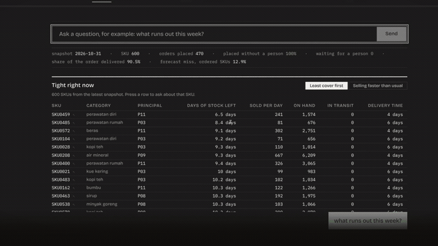

# Pasok

Pasok is Indonesian for "to supply". It is a four-agent replenishment system for an FMCG distributor in Greater Jakarta: it reads what is on hand, forecasts demand against a real Indonesian calendar, decides how much of each SKU to order, sends the order into the order system, and then checks its own decisions once the goods arrive.

It was built for Agentic AI (SAP) 2026, Track A, intelligence supply chain. Team: Vicentius Elang Krisnanto, Sistem Informasi, Universitas Katolik Atma Jaya.

**Status:** finalist top-40. Demo Day 31 October 2026, 15 minutes, English.

[](media/demo-day-2026.mp4)

The clip above is the console answering "what runs out this week?" with 11 SKUs and IDR 193,071,250 in orders already placed. Click it for the full Demo Day recording (3 minutes 52 seconds, 28 MB, [media/demo-day-2026.mp4](media/demo-day-2026.mp4)).

## The problem

Traditional trade still moves roughly 69% of Indonesia's FMCG volume (Statista, 2025), almost all of it through warehouses like this one. The purchasing manager's tool is a fixed reorder point per SKU and a safety stock number copied from last year.

That tool fails in every direction. Fast movers run dry before the next delivery and the sale goes elsewhere. Slow movers pile up as cartons of borrowed capital. Lead times are assumed rather than measured, so the reorder point is wrong in a way nobody can see.

Above all of it moves the calendar. Ramadan and Lebaran, Imlek, Nyepi, the THR weeks, payday, principal promotions. Each one announces itself weeks ahead as a quiet stretch of small orders, and each one drifts across the Gregorian year, so "March is our best month" stops being true within a few seasons. Every SKU also carries a sellable window, months rather than years, which caps how early pre-event stock can be built. Build too early and the excess becomes expiry waste.

The data to do better already sits inside the business. Sales invoices per outlet and SKU live in the order capture system, receiving records hold each principal's real lead times, and the peaks are visible in those records. What the business lacks is a layer that reads the signals, plans for the peak, sizes every order against shelf life, and executes. Its screens stop at reports, and a person still places orders weekly at best.

## How it works

One loop, five steps, and it repeats.

1. See the stock position.
2. Forecast sales per SKU.
3. Decide the order.
4. Send it to the order system.
5. Score the outcome after the goods arrive.

Eleven programs run that loop in order, from preparing the calendar to writing the trace for one sample SKU. In a normal week nobody has to run them by hand. `bash run_chain.sh` is enough, and it prints `CHAIN OK` when the whole loop reconciles.

Four agents fill the five steps.

| Agent | Reads | Produces |
|---|---|---|
| Demand | sales history per outlet, event calendar, learned ramp class | a daily forecast per SKU with an uncertainty band, and a flag when a series rises with no event to explain it |
| Stock Position | warehouse stock, goods in transit, open purchase orders | one sellable number, days of cover, a reorder flag, an expiry-risk flag |
| Supplier Reliability | receiving records | lead time p50 and p90, fill rate, a drift flag |
| Decision | the three outputs above, credit headroom, shelf life, holding cost | one action per SKU, a quantity, and a reason a buyer can read |

Three guardrails sit between the Decision Agent and the order. Then the orders leave.

SAP AI Core scores the exception queue and writes the reasons. Joule shows the queue to the buyer. The learn step closes the loop by comparing what arrived with what was forecast.

Forecasting, the guardrails and the order arithmetic are deterministic code. The language model writes the reasons and answers the console. It never touches a quantity.

### One sellable number

Warehouse stock, goods in transit and open purchase orders are three separate numbers in most systems, and a buyer who looks at only the first one orders again while the same goods are already on a truck. Pasok adds them into one number: what can actually be sold today.

Two flags come out of it, and they mean opposite things. The reorder flag means the goods will run out: days of cover is below the lead time plus a seven-day cushion. The expiry flag means the goods will sit too long: days of cover is longer than the SKU's shelf life.

On the 31 October snapshot, 38 of 600 SKUs carry the reorder flag and 6 carry the expiry flag.

### A forecast with a per-SKU ramp

The forecast is statistical, per SKU. History gives a base rate, the calendar gives an event multiplier, and the product of the two is the effective forecast. Each SKU also learns its own shape around each event: across the catalogue, 1,672 SKU-and-event combinations rise once and fall back, and 1,328 build up gradually. One event pattern for every product would be wrong in both directions, because biscuits climb steeply before Lebaran and other goods do not move at all.

The payday multiplier is switched off, and that decision has data behind it. Sales data carries no promotion marker, so payday lift had to be estimated as one pooled number per SKU over 39 months. The result was not usable: lift per SKU per month ranged from 0.84 to 1.58 with a within-SKU standard deviation of 0.33, a quarter of the months showed no lift at all, and this month's lift barely predicts next month's (correlation minus 0.27). The uncertainty moved into the buffer instead, measured from the 75th to 90th percentile of that SKU's own payday lift.

Turning it off costs nothing. In a 284-day replay from 1 January to 11 October 2026, demand lost to empty shelves came to 806,996 units (0.717%) with payday, and 791,519 units (0.703%) without. Average stock value moved from Rp284.0 bn to Rp284.5 bn and turns from 6.41 to 6.40. Switching payday off cut 15,477 lost units and added no stock. Across the demo run, 116 of 139 order lines carried the multiplier, and disabling it removed 55,465 of 1,015,276 ordered units, about 5.46%.

The multiplier comes back on one condition: the promotion schedule has to arrive before payday, listing the SKU, the discount depth and the period. With that list, the lift can be computed from each SKU's price elasticity instead of from history.

### A calendar with the right dates

Event dates are read from the Indonesian calendar, not hard-coded per year. Ramadan and Lebaran follow the government's SKB 3 Menteri, Nyepi follows the Balinese saka calendar, Imlek is looked up from a lunar table, and the THR payout is anchored to Lebaran as Permenaker 6/2016 requires.

The first version guessed Imlek with `year % 3`. It put the holiday on 13 February 2024; the real date was 10 February. That is the kind of error a hard-coded rule makes quietly, and the reason the registry is looked up and then checked against the generated data:

```
Nyepi   2023-03-22   2024-03-11   2025-03-29   2026-03-19
Imlek   2023-01-22   2024-02-10   2025-01-29   2026-02-17
Lebaran 2023-04-22   2024-04-10   2025-03-31   2026-03-20
```

Valentine's Day and St Patrick's Day are left out on purpose. They do not move Indonesian general trade volume, so modelling them would add registry rows that predict nothing. `src/demand/registry_catalog.py` records that exclusion next to the inclusions.

### Suppliers measured by receipts

Every delivery is a measurement. The receiving records give each principal a lead time p50 and p90 and a fill rate, plus a flag when the recent pattern drifts away from the long-run one. Those numbers are not decoration. Lead time p90 sets the cover target, and fill rate divides the order, because a supplier who ships 85% of what is asked needs an order of 100 to deliver 85.

### Order arithmetic

Cover target, order quantity, and the shelf-life ceiling are three lines of arithmetic.

- Cover target = lead time p90 + review period + buffer.
- Buffer uses the SKU's service level: z of 1.645 for class A, 1.28 for B, 0.84 for C.
- Order = (cover target × effective forecast − sellable) ÷ supplier fill rate.

The shelf-life ceiling caps an order so the goods sell out before they expire: shelf life minus one review period, with a floor of two days. Anything above the ceiling is not ordered now, it waits for the next review. For short-life goods being prepared for a distant event, this is what makes the buying gradual. The rule never bound on the demo catalogue, where the shortest shelf life is 180 days, and it was tested on its own case: 140 SKUs, 21-day shelf life, 15-day lead time p90, where spoilage fell from 3.81% to 2.68%.

A worked example from the demo run. SKU0361 has a 7-day lead time p90, a 7-day review period and a 7-day buffer, so its cover target is 21 days. The effective forecast is 570.4 units per day and sellable stock is 4,707.6 units. 21 × 570.4 = 11,978.4, minus 4,707.6 = 7,270.8, divided by a 0.85 fill rate = 8,554.9 units. The recorded order is 8,554.6 units, and the difference is rounding.

Products are also split into ABC classes by value, not unit count: 262 SKUs carry the first 80% of sales value, 178 carry the next 15%, and 160 carry the last 5%. Class A gets the thickest buffer and the first claim on warehouse space and credit. Class C carries the loosest days-of-cover cap at 90 days, against 60 for A and B, because slow movers can sit longer without blocking the shelf. In the demo run class A held 69 of 139 order lines and 730,086 of 1,015,276 ordered units.

### Order guardrails

Supply chains amplify. A small wobble in demand becomes a larger wobble in orders, the supplier plans production against the larger number, and the cost comes back as price and idle stock. Three guardrails sit between the decision and the order: the forecast is smoothed before it is used, the order quantity is pulled part of the way toward the previous order, and there is a cap on how much a single order may rise from one week to the next.

A rise caused by an event is exempt. If Lebaran lifts demand, the order is allowed to rise, because that is real demand rather than stock panic.

On a 250-day simulation using the Bank Indonesia retail sales index, orders without guardrails swung 2.68 times the demand swing; with guardrails they swung 0.24 times. Fill rate gave up a little, going from 98.93% to 98.68%. A separate 104-day replay inside the system moved amplification from 1.27 to 0.36, a 71.8% reduction.

One honest note for the demo: on the live snapshot none of the three guardrails bound. All 600 rows carry the flag `none`, and the quantity before and after the guardrail is identical, because the lowest fill rate was 0.832 while the variance cap only starts below 0.80, and this was the first run of the day so there was no previous order to be pulled toward. The right sentence is that the guardrails work in replay, and that this snapshot did not trigger one.

### Actions, reasons, and the queue

Every SKU ends with one of four actions: order automatically, hold one cycle because stock already covers the horizon, redirect to a branch that has excess, or escalate to a person.

The reason is written the way a buyer needs it, and it is checkable. For SKU0361 the reason reads: the order covers 21 days, which is 7 days of worst-case delivery, 7 days until the next review, and 7 days of slack for lead-time and demand movement; the SKU can sell 4,708 units and sells about 570 a day; the guardrail did not cut this order.

The wording comes from a language model. The numbers come from the arithmetic, and a wrong sentence cannot change a quantity.

A line leaves the automatic path when it rests on an assumption a person should authorise: the credit line is too thin, the incumbent supplier has drifted and another principal already carries the category, the order cannot clear the supplier's minimum, warehouse space is not there, or the cover target lands above the class cap. Those lines wait in the exception queue. That queue is the human's job, and it is the only place a person has to look.

### Sending the order, and redirecting the surplus

Orders go to the order system through an interface that a stand-in ERP implements. The stand-in speaks the same calls as the real one, so replacing it is one environment variable rather than a rewrite.

Excess stock does not wait for a promotion to clear. The redirect step matches a branch holding too much of a SKU with a branch selling it, and transfers the difference. In the demo run that meant 467 transfers across 5 depots, protecting Rp10,216,545,412 of the Rp15,512,068,197 that was exposed to expiry or idle capital.

### Learning from what arrived

The last step compares what was ordered and what arrived against the forecast that justified them. That gives the fill rate the system actually achieved, the forecast error on SKUs where history was held out, and a learning curve by month. On the 31 October snapshot: 470 decisions, observed fill rate 90.47%, and a median held-out WAPE of 12.91%.

Accuracy is scored on realised supply and logistics plus the held-out forecast error, never on a snapshot cover comparison. Order sizing is event-inflated on purpose, so comparing cover on one date would measure the calendar rather than the model.

### The console

The console is a read-only view of the same artefacts the loop writes. It has pages for stock health, orders, the loop, suppliers, transfers, catalog, geography, receiving and the approval panel, plus a question box. It answers the six questions a buyer asks in a week: what runs out, what is overstocked, what is waiting for me, what did the system order today, which suppliers are slipping, and where should stock move. Answers are assembled from computed facts, so a page and an answer cannot disagree.

## Results

Everything below comes from the artefacts in `data/`, produced by `bash run_chain.sh` on the 31 October 2026 snapshot.

| Measure | Value | Source |
|---|---|---|
| Catalogue | 600 SKUs, 120 outlets, 1,399 days, 10,034,120 sales rows | `data/catalog/meta.json` |
| Decisions | 470 ordered, 130 held | `data/agents/decision_summary.json` |
| Units guarded | 3,169,930 of 3,194,155 raw, variance cap on 8 SKUs | `data/agents/decision_summary.json` |
| Order value | Rp30,123,910,900, all auto-issued | `data/orders/order_summary.json` |
| Warehouse load | 3,195.1 of 12,500 m³ | `data/orders/order_summary.json` |
| Transfers | 467 across 5 depots | `data/orders/redirect_summary.json` |
| Value at risk protected | Rp10,216,545,412 of Rp15,512,068,197 | `data/orders/redirect_summary.json` |
| Fill rate | 90.47% | `data/agents/learn_summary.json` |
| Median held-out WAPE | 12.91% | `data/agents/learn_summary.json` |
| Stock flags | 38 below reorder, 6 expiry risk | `data/stock/position_summary.json` |
| Lost sales | 880,472 units | `data/stock/position_summary.json` |

The Demo Day run on 21 October 2026 produced 139 order lines: 121 auto-issued at Rp13,421,740,570 and 18 escalated at Rp3,437,202,355. The module and the deck quote that snapshot, which is why their figures differ from the table above.

## Run it

You need Python with pandas, numpy, pyarrow and matplotlib. The chain was last run on Python 3.8.10.

```bash
python -m venv .venv
.venv/bin/pip install pandas numpy pyarrow matplotlib

# generate the synthetic catalogue (about 90 seconds, writes a 240 MB CSV)
PYTHONPATH=. .venv/bin/python src/catalog/generate.py

# run the eleven programs
bash run_chain.sh
```

Each agent prints `VERIFICATION PASS` when its output reconciles with its input, and the run ends with `CHAIN OK`.

`data/catalog/sales.csv` is generated, not shipped, because it is about 240 MB, so that file is not in the repo. The committed artefacts under `data/` are what the docs quote.

## Run the console locally

```bash
.venv/bin/pip install -r requirements-web.txt
PASOK_WEB_PORT=8080 .venv/bin/python web/app.py
```

Checked here on Python 3.8: `/`, `/orders`, `/loop`, `/health`, `/suppliers`, `/transfers`, `/catalog` and `/panel` all return 200.

## Services

| Service | Port | Entry point |
|---|---|---|
| Console | 80 in production, 8080 locally | `web/app.py` |
| MCP server | 8086 | `mcp_server.py` |
| A2A server | 8085 | `a2a_server.py` |

`web/pasok-web.service` is the systemd unit used on the demo machine. The MCP and A2A servers need Python 3.10 or newer because they depend on `fastmcp`.

## Checks

`tools/` holds the checks, and they are meant to be run.

```bash
.venv/bin/python tools/integration_audit.py    # the eleven hand-offs, 11 passed
.venv/bin/python tools/test_cases.py           # the scenario tests
.venv/bin/python tools/proposal_conformance.py # the proposal requirements, one line each
.venv/bin/pip install python-pptx
.venv/bin/python demo/deck/check_deck_numbers.py # every figure in the deck against the artefacts
```

The deck check reports nine drifted claims, because the deck quotes the 21 October snapshot while the artefacts moved to 31 October. That is a finding, not a failure of the check.

Two audit commands need inputs that do not ship. `tools/target_measure.py` reads `data/sim/replay2026_m/world/stock_daily.csv`, and `tools/figures_gate.py` reads the figures sheet. Both are regenerated by the replay tooling rather than committed.

## Layout

```
src/agents/      the four agents and the loop (perceive forecast decide issue learn)
src/catalog/     synthetic distributor catalog generator (SKU x outlet x week)
src/demand/      baselines, event registry, per-SKU ramp learner
src/sap/         sap-rpt-1.6 batch scoring, gpt-5.4 rationale
tools/           audits, backtests, benchmarks, the stand-in distributor ERP
web/             read-only console and the approval panel
data/            artefacts the loop reads and writes (generated, mostly committed)
demo/            demo package: script, slides, figures, evals, architecture
aws/             AWS gate status and reproduction commands
simulation/      guardrail simulation on the Bank Indonesia retail index
experiments/     M5 event-ramp evaluation
docs/            module, audit, proposal PDF, test findings
proposal_pasok_v2_canonical.txt   the submitted proposal, the source of truth
```

## What is not in this repo

`.planning/` (the build diary), `sources/panitia_pdfs/` (organiser briefing PDFs), the raw video footage under `demo/video/` (the 3m52s demo edit ships as `media/demo-day-2026.mp4`), `data/catalog/sales.csv` and `data/stock/stock_daily.csv` (both regenerated by the two commands above). The build paperwork stays out too: internal review notes, the experiment plan and tracker, deploy logs, organiser correspondence, the slide previews and the scripts for the previous deck design.

## What is real and what is a stand-in

Read `demo/evals.md` before quoting any number.

- Scoring and reasoning run on SAP AI Core: sap-rpt-1.6 batch predict for days-of-cover, stockout and expiry, and gpt-5.4 for the rationales. The last run returned HTTP 200 with 600 predictions in 10.73 seconds.
- The human in the loop is Joule: `pasok_exception_queue` is live in the tenant. The console's approval panel shows the same queue for the demo.
- The AWS lane runs on Lambda with Bedrock through the Mantle endpoint. AgentCore Runtime and Memory are not wired: the quota on this account is zero and the increase request was refused.
- The distributor's order system is a stand-in that speaks the same calls, controlled by one environment variable. It is not SAP S/4.
- The catalogue is synthetic, generated by `src/catalog/generate.py` with a fixed seed. The event catalogue is real, the demand shapes are modelled on public Bank Indonesia and M5 data, and the organiser rules allowed a synthetic catalogue.

## Limits

- The catalogue is 600 SKUs. A mid-sized distributor in Jakarta runs about 2,500, and at that size warehouse space breaks before the forecast does.
- The expiry flag and the SAP RPT score disagree by design: the agent compares days of cover with the full shelf life, while RPT was trained on a 14-day label. RPT flagged 577 of 600 SKUs where the agent flagged none, and the two agree 89.5% on stockout. That is why the RPT score is a second opinion rather than a gate.
- The XYZ volatility split exists in the data but does not separate anything yet: all 600 SKUs land in the same class.
- The deployed Lambda answers from an older bundled snapshot than the local artefacts, so its numbers lag the console until it is redeployed.
- `docs/MODUL_PASOK.md` and `docs/AUDIT_MODUL.md` are written in Indonesian for the Indonesian panel. The rest of the documentation is English.

## Demo Day

Demo Day was 31 October 2026 at BINUS Alam Sutera. The materials are in `demo/`: `demo/script_en.md` is the timed 15-minute script, `demo/slides_outline.md` follows the deck slide by slide, `demo/QA_BANK.md` holds 16 prepared answers, and `demo/REHEARSAL.md` records what was rehearsed and when. The recording ships as `media/demo-day-2026.mp4`.

## Documents

| File | What it is |
|---|---|
| `docs/MODUL_PASOK.md` | the 22-section module, written in Indonesian for the Indonesian panel |
| `docs/MODUL_PASOK.pdf` | the same module as a print-ready PDF |
| `docs/AUDIT_MODUL.md` | every figure in the module checked against the artefacts |
| `demo/script_en.md` | the timed 15-minute Demo Day script |
| `demo/evals.md` | what is proven and what is not |
| `docs/PASOK_PROPOSAL_v1.pdf` | the 3-page proposal sent to the organisers |
| `proposal_pasok_v2_canonical.txt` | the same proposal as plain text, the version the build follows |

## Credits

Built by Vicentius Elang Krisnanto for Agentic AI (SAP) 2026. MIT licence, see `LICENSE`.
Contact: elangk111@gmail.com · [github.com/Elang02](https://github.com/Elang02)
