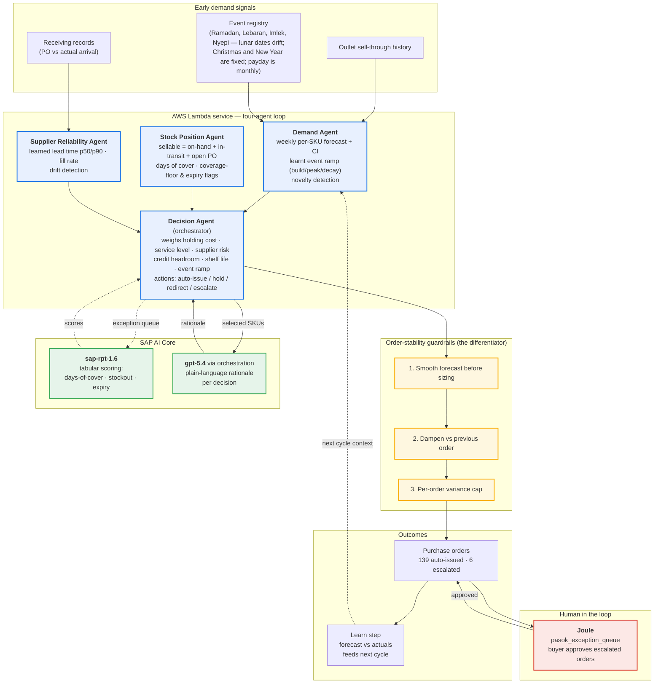

# Pasok — Architecture (Demo Day)

Four-agent replenishment system for Indonesian FMCG distributors, running as an AWS Lambda
service with Bedrock inference through the Mantle endpoint, with SAP as the business system.
AgentCore Runtime is account-gated on this account (quota `Total Agents per Account` = 0,
increase refused), so the loop does not claim to run there.

## Reading the diagram

- **The four agents** run as one Lambda service, in process, with Bedrock inference served
  by the Mantle endpoint because native `Converse` is account-gated. The heavy
  number-crunching (forecast, ramp fit, guardrail math, RPT scoring) runs in the offline
  pipeline and hands the service its per-SKU evidence. AgentCore Runtime and Memory are
  blocked on this account, so neither appears as a running component.
- **The guardrails sit between the Decision Agent and the order** — that is where the
  bullwhip is killed. They are not a post-filter; they shape the quantity before it is
  ever issued.
- **SAP AI Core** scores the exception queue with RPT-1.6 and writes the rationale with
  gpt-5.4 through the orchestration deployment.
- **Joule** is the human moment: the buyer sees the escalated queue and approves.
- **The learn step** closes the loop: actual arrivals vs the forecast feed the next
  cycle's context.
